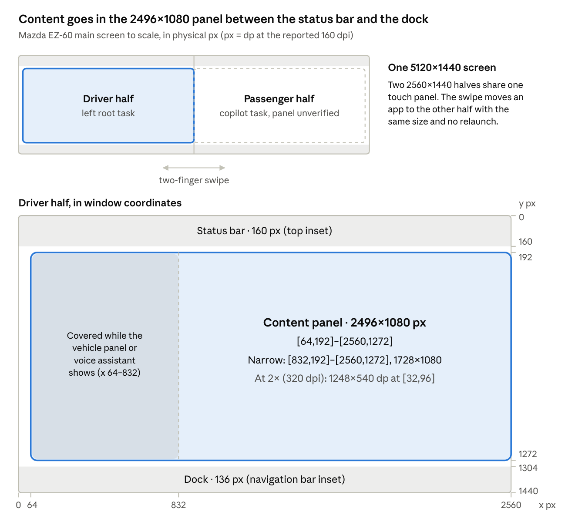
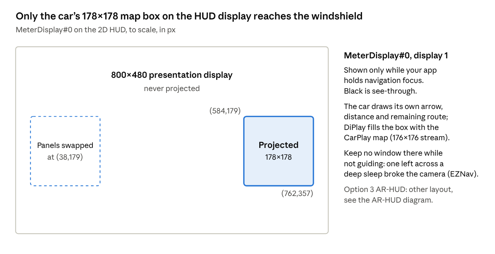
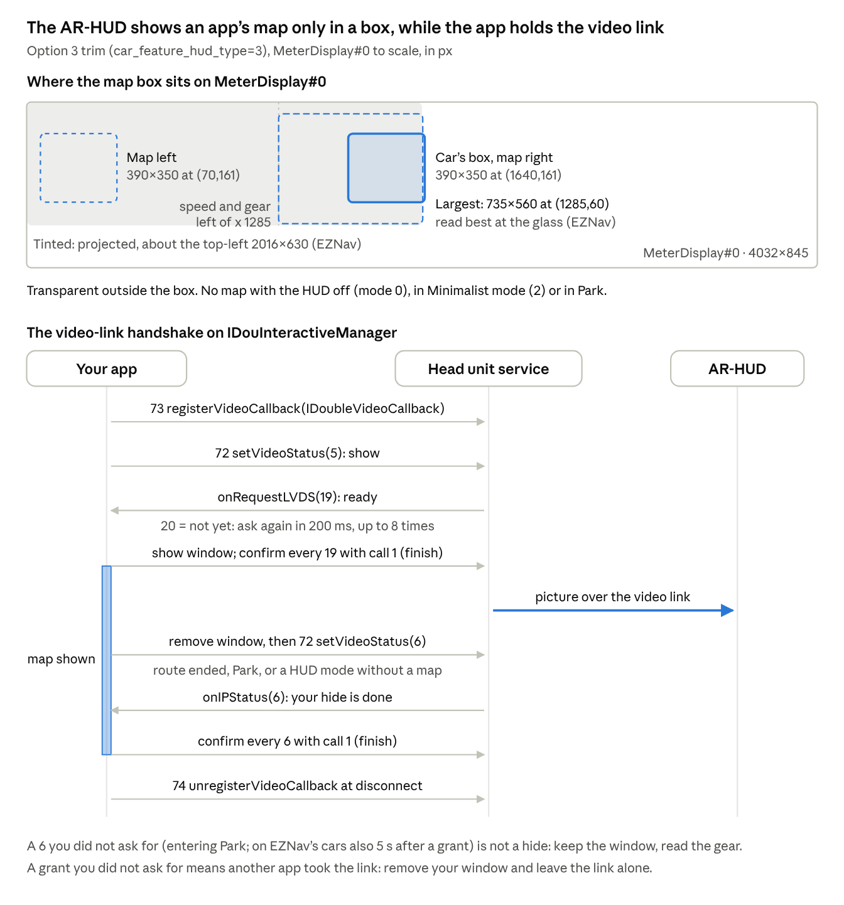

# Mazda EZ-60 App Developer Guide

Oct 17, 2026 · @Vib3C0der

Every app on the EZ-60 runs on an Android 14 Automotive head unit (MediaTek MT8676) that drives one 5120×1440 touchscreen as two 2560×1440 halves. Design for one half: Android reports 160 dpi (1 dp = 1 px, about 0.126 mm), the status bar takes the top 160 px, the dock the bottom 136 px, and the car's own apps draw in a 2496×1080 panel at \[64,192\]–\[2560,1272\].

Everything below was measured on our car with DiPlay's EZ-60 probe (October 2026) or read from the car's own apps. DiPlay runs on all three trims: Options 1 and 2 take its 2D HUD path and Option 3 its AR-HUD path, and testers reported it working on all three on 2026-10-18. Points that are not measured are marked *unverified*.

## At a glance

Detect the car with `Build.MODEL == "J90K"`; that is the check DiPlay uses for every EZ-60 default.

| Item | Value |
| --- | --- |
| Car | Changan Mazda EZ-60, Chinese market, platform J90K |
| Build identity | manufacturer `WUTONG`, brand `TINNOVE`, model `J90K`, product `vext_wt_car`, device `auto8676p1_64_bsp` |
| OS | CAMZD OS on Android 14 (SDK 34), Android Automotive (`android.hardware.type.automotive`), uiMode type CAR, security patch 2024-09-05, `user/test-keys` build |
| Firmware seen | `SWD.83.9` (2025-09-30, our 2D HUD car) and `SWD.26.8` (2025-12-31, an AR-HUD car) |
| SoC | MediaTek MT8676 (`Build.HARDWARE = mt8676`; `Build.SOC_MODEL` says MT8646), arm64-v8a only, no 32-bit ABI |
| Main screen | one 26.45" 5120×1440 (32:9) panel, 60 Hz, HDR types 2/3/4, 500 nits |
| Real pixel size | about 0.126 mm (201 ppi); Android reports 160 dpi, density 1.0 |
| App window | 2560×1440 px per half, status bar 160 px, dock 136 px |
| Touch | one panel, `ChangAn_MFD-Touchscreen`, x 0–5119, y 0–1439, multi-touch |
| Second display | `MeterDisplay#0` (display 1), a presentation display that feeds the windshield HUD: 800×480 on the 2D HUD, 4032×845 on the AR-HUD |
| Instrument cluster | none; the HUD is the driver's only other screen |
| Audio | 48 kHz, 1024 frames a buffer, fixed volume (the car sets it), AAOS output buses |
| Video decoding | MediaTek Codec2 H.264 and HEVC up to 4096×2176 |
| Wi-Fi | 2.4/5/6 GHz, Wi-Fi 6 (11ax), Wi-Fi Direct, hotspot and client at once |
| Bluetooth | classic and LE; hands-free (HFP HF), A2DP sink and AVRCP controller only |
| Location | GPS (MediaTek GNSS), fused and passive providers |
| Sensors | accelerometer, barometer, step counter; no light sensor |
| Home app | `com.tinnove.launcher` |

## Screen and layout

An app gets one 2560×1440 px half and should put its content in the 2496×1080 panel that the car's own apps use. Coordinates are in the window, in px; at the system's 160 dpi, px = dp.



The car's apps keep a 64 px left margin and 32 px of air under the status bar and above the dock; the passenger half is assumed to mirror this.

| Region (driver half) | Bounds \[left,top\]–\[right,bottom\] | Size (px) |
| --- | --- | --- |
| Window | \[0,0\]–\[2560,1440\] | 2560×1440 |
| Status bar inset (top) | \[0,0\]–\[2560,160\] | 2560×160 |
| Dock inset (bottom, `navigationBars`) | \[0,1304\]–\[2560,1440\] | 2560×136 |
| App bounds after insets | \[0,160\]–\[2560,1304\] | 2560×1144 |
| Car apps' content panel | \[64,192\]–\[2560,1272\] | 2496×1080 |
| Narrow panel (left vehicle panel or voice assistant open) | \[832,192\]–\[2560,1272\] | 1728×1080 |
| Passenger panel, mirrored (*unverified*) | \[0,192\]–\[2496,1272\] | 2496×1080 |
| Passenger narrow panel (right voice assistant open, *unverified*) | \[0,192\]–\[1728,1272\] | 1728×1080 |

On the passenger half, screen x = window x + 2560. Gesture insets match the bars (160 top, 136 bottom); there is no cutout, no caption bar and no rounded display corners.

**Density.** The car sets `ro.config.density_override=160`, so a stock app sees `sw1440dp`, `w2560dp`, `h1144dp` and lays out like a huge tablet. One dp is only 0.126 mm here (Android assumes 0.159 mm), so text and touch targets come out at 79 % of their intended size, and look tiny from the driver's seat.

- DiPlay scales its own screens until the shorter side is 720 dp: 2×, or 320 dpi, giving `sw720dp`, `w1280dp`, `h572dp` per half. It applies this with `applyOverrideConfiguration` in `attachBaseContext` (`InterfaceSize.kt`).
- Recommended baseline: design each half as 1280×572 dp at 2×. The content panel is then 1248×540 dp at \[32,96\], and a 48 dp touch target is 96 px, about 12 mm.
- Do not scale video or a map surface that the app sizes in px.

**Panel behaviour.**

- The car narrows the panel while its left vehicle panel or a voice assistant shows. Watch these `Settings.Global` keys with a `ContentObserver`: `key_screen_show` (non-zero, -1 seen, while the left vehicle panel shows), `key_vpa_cui_show_left` and `key_vpa_cui_show_right` (1 while the voice assistant shows on that side). DiPlay animates the panel edge over 300 ms.
- In panel mode DiPlay leaves the window background transparent, so the car's desktop shows around the panel as it does around the car's apps. Its panel has 8 dp rounded corners; CarPlay video uses 80 px at 1080 px tall.

**Theme.** Every report shows `uiMode=0x23` (car, night). We never saw the car switch to a light theme, so design dark-first and keep `values-night` resources complete.

## Windows and displays

Each half is its own root task, and the driver's two-finger swipe moves a whole task to the other half in about 0.2 s without resizing or relaunching it. Apps must take that as a configuration change.

**Tasks.** Apps run in `multi-window` mode inside one of two root tasks: the left (driver) root, whose id is in `Settings.Global` `task_view_leftRootTaskId`, and the right "copilot" root. The maximum window bounds are the whole 5120×1440 screen.

**The swipe.**

- The task is reparented between the two roots. The app gets `onConfigurationChanged` with the new bounds (\[0,0\]–\[2560,1440\] or \[2560,0\]–\[5120,1440\]); the size stays 2560×1440.
- No measure pass follows, so a layout that depends on the side must check `getLocationOnScreen()` in an `OnGlobalLayoutListener`. For a moment the configuration bounds and the decor position can disagree.
- Declare `android:configChanges="density|keyboardHidden|orientation|screenLayout|screenSize|smallestScreenSize|uiMode"` and `android:resizeableActivity="true"`, as DiPlay does, so a long-running session survives.
- `Settings.Global` `fly_to_right_status`: 1 while moving to the passenger half, 2 while moving back, 0 otherwise.

**Which app is where.** `Settings.Global` `main_display_status` and `copilot_display_status` hold `"<key> 1 <package> <activity>"` for the top app on the driver and passenger half, or `"<key> 0"` when the half is empty.

**New tasks.** An activity started in a new task (own `taskAffinity`, `singleTask`) opens on the half of the app that started it; tested twice on each half. Opening an app from the other half's app list moves its existing task to that half. Keep secondary screens in the same task if they must move with the app: DiPlay dropped a separate `taskAffinity` because the swipe left its menu behind.

**Displays.**

| Display | Id | Size | What it is |
| --- | --- | --- | --- |
| `Built-in Screen` | 0 | 5120×1440 @ 60 Hz | the touchscreen, both halves |
| `MeterDisplay#0` | 1 | 800×480 (2D HUD) or 4032×845 (AR-HUD) | presentation display behind the windshield HUD; `FLAG_PRESENTATION`, not touchable |

On the 2D HUD only the car's map box, 178×178 px at (584,179) (at (38,179) when the driver swaps the HUD panels), of `MeterDisplay#0` is projected, and only while your app holds the HUD's navigation focus (see Windshield HUD). Black is not projected. On the AR-HUD trim the display is 4032×845 and shows an app only after a video-link handshake (see AR-HUD); otherwise never draw on `MeterDisplay#0` there. Find the display with `DisplayManager.getDisplays(DISPLAY_CATEGORY_PRESENTATION)` and match its size.

**Keep windows off `MeterDisplay#0` when you do not need them.** On the AR-HUD, DiPlay has always shown its window there only while it holds the video link, and removes it when guidance ends, in Park and when the car is switched off. With that, our tester's Option 3 car showed no camera or dash-camera fault. DiPlay's current build does the same on the 2D HUD: its window exists only while it guides on the HUD and is removed at switch-off. The EZNav developers report that the car's HUD display service reads every window on that display about once a second, and that on their 100-inch cars a window left there across the head unit's deep sleep broke the surround-view and reverse camera.

## Audio

The car routes sound by `AudioAttributes` usage to fixed output buses and sets the volume itself, so an app picks the right usage and never touches volume. Two rules matter most: do not take audio focus from the car's Bluetooth player, and record the microphone with `VOICE_RECOGNITION`.

**Format.** 48 kHz, 1024 frames a buffer, low-latency audio and AAudio MMAP available. `AudioManager.isVolumeFixed()` is true.

**Pick the usage.**

| What you play | Usage | Bus it should reach |
| --- | --- | --- |
| Music, video sound | `USAGE_MEDIA` | `bus0_main_media_out` (DiPlay plays CarPlay music this way) |
| Turn-by-turn prompts | `USAGE_ASSISTANCE_NAVIGATION_GUIDANCE` | `bus7_navigation_out` (by name, *unverified*) |
| Voice assistant replies | `USAGE_ASSISTANT` | a voice command bus (DiPlay plays Siri this way) |
| Calls | `USAGE_VOICE_COMMUNICATION` | `bus4_bt_bcall_out` (by name, *unverified*) |
| Ringtone | `USAGE_NOTIFICATION_RINGTONE` | `bus11_phone_ringtone_out` (by name, *unverified*) |

All output buses, product `J90K`, type BUS, 48 kHz: `bus0_main_media_out`, `bus2_secondary_media_out`, `bus4_bt_bcall_out`, `bus5_fl_voice_command_out`, `bus6_system_sound_out`, `bus7_navigation_out`, `bus8_bt_headest_music_out`, `bus9_inside_mic_ktv_out`, `bus10_outside_mic_ktv_out`, `bus11_phone_ringtone_out`, `bus12_fr_voice_command_out`, `bus13_rl_voice_command_out`, `bus14_rr_voice_command_out`, `bus15_dolby_atmos_out` (4 to 12 channels), `bus16_outside_shout_out`, `bus17_sound_wave_out`. All are stereo except the Dolby Atmos bus. The usage-to-bus table lives in the car's audio configuration, which we have not read.

**Audio focus.**

- When the phone plays over the car's own Bluetooth, the media center's Bluetooth player holds Android audio focus and sets `Settings.Global` `bt_source_focus_key=1`.
- If another app takes focus from it, that player sends AVRCP pause, and the phone stops. Before `requestAudioFocus`, check `bt_source_focus_key`. While it is 1, play without requesting focus. This fixed CarPlay music pausing by itself.
- The car's phone stack takes transient focus (`AUDIOFOCUS_LOSS_TRANSIENT`) about 2 s before a call rings; `system.HARD_KEY_PRIORITY=1025` and `global.call_incoming_sing_status=2` mark an incoming call.

**Microphone.**

- Inputs: `mic` (type 15, address `bottom`, 1 to 8 channels, 8 to 48 kHz), `telephony` (18), remote submix, FM tuner and an unnamed type 28.
- The car always runs its own captures: `CAMCORDER`, `VOICE_RECOGNITION` and `VOICE_PERFORMANCE` (its wake word). During a call, Android silenced DiPlay's `MIC` and `VOICE_COMMUNICATION` captures: `isClientSilenced()` true and all-zero samples, even with the car's Bluetooth off.
- `VOICE_RECOGNITION` got real audio (peak 4779) and fixed CarPlay calls. Use it, without `MODE_IN_COMMUNICATION` or platform echo cancellation, and check `AudioRecordingConfiguration.isClientSilenced()`. DiPlay falls back to `VOICE_COMMUNICATION`, then `MIC`, after 0.75 s of silence.

## Video and codecs

Use hardware H.264 at up to one half's size: no decoder accepts the full 5120-wide screen (the limit is 4096×2176), and HEVC is about three times slower than H.264 here.

| Decoder | Type | Max size | 2496×1080 | 2560×1440 |
| --- | --- | --- | --- | --- |
| `c2.mtk.avc.decoder.lowlatency` | H.264, hardware, low-latency | 4096×2176 | 87–191 fps | 64–141 fps |
| `c2.mtk.avc.decoder` | H.264, hardware | 4096×2176 | 87–191 fps | 64–141 fps |
| `c2.mtk.hevc.decoder.lowlatency` | HEVC, hardware, low-latency | 4096×2176 | 32–70 fps | 23–51 fps |
| `c2.mtk.hevc.decoder` | HEVC, hardware | 4096×2176 | 32–70 fps | 23–51 fps |
| `c2.android.avc.decoder` | H.264, software | 1920×1088 | not supported | not supported |
| `c2.android.hevc.decoder` | HEVC, software | 1920×1088 | not supported | not supported |

Frame rates are Android's "achievable" range from `MediaCodecInfo`. Each hardware decoder allows 15 instances. The `OMX.MTK.VIDEO.DECODER.*` names are only aliases of the Codec2 decoders.

**What worked for DiPlay (CarPlay, 2496×1080, 60 fps):**

- `c2.mtk.avc.decoder.lowlatency`, with frames released from their own output thread: decode 4–5 ms (p90 7–11 ms), 43–59 fps on screen, touch to picture 21–60 ms.
- The low-latency decoder can stall mid-session; DiPlay then moves to `c2.mtk.avc.decoder` until the next session.
- Android's software HEVC decoder took 19–67 ms a frame. Never fall back to it.
- A `SurfaceView` saves a GPU copy compared with `TextureView`, because the car's 3D desktop draws on the same 5120×1440 screen. Rounded-corner clipping may not apply to a `SurfaceView`.
- Two decoders can run side by side: DiPlay decodes a 232×192 HUD map stream next to the main stream.

Graphics: OpenGL ES with AEP and Vulkan compute are available. The display reports HDR types 2, 3 and 4 (HDR10, HLG, HDR10+) at 500 nits.

## Input

One touch panel covers both halves, and the steering-wheel media buttons arrive as standard Android media keys, so a normal `MediaSession` handles them.

**Touch.** Device `ChangAn_MFD-Touchscreen` (vendor `0x3456`), x 0–5119 and y 0–1439 in screen coordinates, multi-touch with 5 or more points. The system uses a two-finger horizontal swipe to move the app to the other half. Do not build an app gesture on it; whether apps also receive those touches is *unverified*.

**Keys seen on the car.**

| Button | Key code | Scan code | Device |
| --- | --- | --- | --- |
| Wheel: previous | `KEYCODE_MEDIA_PREVIOUS` (88) | 60 | `mtk-kpd` (id 2) |
| Wheel: next | `KEYCODE_MEDIA_NEXT` (87) | 59 | `mtk-kpd` |
| Wheel: play/pause | `KEYCODE_MEDIA_PLAY_PAUSE` (85) | 314 | `mtk-kpd` |
| Camera button (opens the surround-view camera, `com.tinnove.evs`) | 1022, vendor code | 306 | `mtk-kpd` |
| System back | `KEYCODE_BACK` (4) | 0 | Virtual (id -1) |

The media keys reached DiPlay's foreground activity and its `MediaSession` (`onMediaButtonEvent`). Never consume key 1022: the car opens its camera view with it. No other wheel button produced a key event for apps in our recordings. `mtk-pmic-keys` is the power key.

## Car services and vehicle data

The car's own services are plain Binder services that a sideloaded app can call without any permission. Get the binder with `android.os.ServiceManager.checkService(name)` by reflection (this worked from DiPlay, target SDK 37), write the interface token, and `transact` the call number. None of this is a public SDK: names and numbers come from the car's own apps and may change with firmware.

| Service name | Interface token | Purpose | Known calls |
| --- | --- | --- | --- |
| `com.incall.SVR_MNG_SERVICE` | `com.incall.serversdk.server.ISvrManager` | hands out the car's "incall" services | 6 `getServer(String name)` → binder |
| `com.incall.double.INTERACTIVE_SERVICE` (from `getServer`) | `com.incall.serversdk.interactive.IDouInteractiveManager` | feeds the windshield HUD | navigation 22, 24, 26, 27, 50, 63, 64; music line 37, 38, 39, 61, 62; AR-HUD video link 1, 72, 73, 74 |
| `tinnove_config` | `com.tinnove.config.aidl.IConfigInterface` | per-trim feature flags | 3 `getValue(String key)` → String |
| `virtualcar_service` | `com.openos.virtualcar.IVirtualCar` | vehicle-property hub | 2 `getVirtualCarService("virtualcar_property_service")` → binder |
| `virtualcar_property_service` (from above) | `com.openos.virtualcar.IVirturalCarProperty` (spelled this way) | vehicle properties | 3 `getValue(int property, int area)`, 4 `isSupport(int property, int area)`; 2 is `setValue`: do not call it |
| `wt.atom` | `com.openos.systemadapter.atom.IAtomInterface` | arbitrated writes for cabin features | 1 `setValue(VirtualCarValue, int priority)`, one-way; the media center uses priority 200 |

**Reading a property.** The `getValue` reply is an int flag (0 = no value), then category, function, area and status (ints), a timestamp (long), the value's class name (string) and the value (`Parcel.readValue`). Status 0 is OK, -202 means the area is not supported, -203 means a write-only signal.

| Property | Area | What it is | Read on our car |
| --- | --- | --- | --- |
| 826278810 | 0 | ambient light brightness | 1 |
| 826278811 | 0, 1 | ambient light colour | 25 / 5 (changes with the car's setting) |
| 826278772 | 0 | ambient scene mode: 1 normal, 2 music | 1, then 2 while the media center plays |
| 826278822 | 1 | rhythm colour, 1–256 | write-only |
| 826278823 | 0 | rhythm brightness, 0–100 | write-only |
| 829424549 | 0 | light zones, byte\[3\]: `[-1,-1,-1]` open, `[0,0,0]` close | write-only |

**Feature flags.** `tinnove_config` keys tell the trims apart. On the AR-HUD car: `car_feature_model=31`, `car_feature_hud_type=3`, `car_feature_hud_display=1`, `car_feature_screen_size=6`, `car_feature_passenger_screen=1`, `car_feature_ethernet=1`, `car_feature_audio_architecture=2`, `car_feature_audio_area=2`, `car_feature_speaker_number=12`, `car_feature_navigation_type=1`, `car_feature_ambient_light_music_rhythm=1`, `car_feature_ambient_lamp_function=6`, `car_feature_interior_camera=1`, `car_feature_panoramic_camera_support=2`, `car_feature_bluetooth_key=1`, `car_feature_wireless_charging=1`. Our 2D car's values are not read yet.

**Car state in `Settings.Global`.** Read with `Settings.Global.getString` and watch with a `ContentObserver`; no permission needed. Keys from `system.` are `Settings.System`.

| Key | What it tells you (values seen) |
| --- | --- |
| `vehicle_acc_status` | power state: 2 when the car switched off; 4 and 5 also seen |
| `bluetooth_on` | the car's Bluetooth, 0 or 1 |
| `bt_source_focus_key` | 1 while the car's Bluetooth music player holds audio focus |
| `system.HFP_CONNECT_STATUS` | phone on hands-free; 0 = none |
| `call_incoming_sing_status`, `system.HARD_KEY_PRIORITY` | 2 and 1025 during an incoming call |
| `tinnove_speech_wakeup_status` | 1 while the car's voice assistant listens |
| `chinatsp.global.LIGHT_RHYTHM_CTL`, `LIGHT_RHYTHM_MODE`, `LIGHT_COLORBAR_CTL`, `LIGHT_BRIGHTNESS_CTL` | ambient light music sync on/off, mode, colour, brightness |
| `system.screen_brightness` | display brightness |
| `wireless_charge_tip` | phone charger state (0, 3, 7, 9 seen; meaning unknown) |

The window keys (`key_screen_show`, `key_vpa_cui_show_*`, `fly_to_right_status`, `main_display_status`, `copilot_display_status`) are in the two sections above.

**Our safety rule.** Read freely, and write only HUD display calls. The car's built-in navigation also drives its assisted driving, and the property service's `setValue` controls the cabin. DiPlay never calls it. Its only property writes are the four ambient-light properties above, through `wt.atom`, allowlisted in code and behind an opt-in switch.

## Windshield HUD

The 2D HUD draws turn arrow, distance and remaining route itself from calls an app makes while it holds the HUD's navigation focus; the app may also draw a map into the car's 178×178 px map box. All calls go to `IDouInteractiveManager` (above).

| Call | Name | Arguments |
| --- | --- | --- |
| 63 | `requestNaviFocus` | String package, strong binder `INaviFocusCallback` |
| 22 | `sendNavigateStatus` | int: 1 not navigating, 2 navigating, 3 simulating |
| 24 | `sendNavigateTurnInfo` | int turn id, int distance in m |
| 26 | `sendNavigateRoadInfo` | String current road, String next road |
| 27 | `sendNavigateRemainInfo` | int remaining m, int remaining s |
| 50 | `sendNavigatePercent` | int route progress 0–100 (driven / (driven + remaining)) |
| 64 | `abandonNaviFocus` | String package, the same callback |

1. Start: 63, then 22 with 2.
2. Each update: 26 when the roads change, then 24, 27 and 50. Send a new turn or road at once, other changes at most once a second, as the car's own navigation does.
3. End: 27 (0, 0), 26 ("", ""), 24 (0, 0), 22 with 1, then 64. Clear only while you hold focus.

The callback is a `Binder` with descriptor `com.incall.serversdk.interactive.callback.INaviFocusCallback`. Call 3 is `onFocusChange(int)`; 1 means you hold the HUD. On any other value, stop sending and leave the other app's guidance alone.

**Turn ids** (the car's own numbering; 3, 16, 18 and 19 confirmed on the HUD):

| Id | Maneuver | Id | Maneuver |
| --- | --- | --- | --- |
| 0 | none (no arrow) | 23 / 24 | U-turn left / right |
| 3 | destination | 53 | enter roundabout, counter-clockwise |
| 16 | straight | 42–51 | exit 1–10, counter-clockwise |
| 17 / 18 | slight or keep right / left | 63 | leave roundabout, counter-clockwise |
| 19 / 20 | left / right | 70 | enter roundabout, clockwise |
| 21 / 22 | sharp left / right | 74–83 | exit 1–10, clockwise |
| 54 | via point | 68 | leave roundabout, clockwise |
| 13 / 11 / 15 | tunnel / toll / service area |  |  |

Roundabout exits are not yet seen on the glass. DiPlay sends 42–51 for counter-clockwise roundabouts (right-hand traffic, as in China and Cambodia), as in the car navigation's converter; the EZNav developers send 74–83. Sending 42, 43, 74 and 75 with guidance active and noting which way each glyph turns would settle it.

**The HUD picture (2D HUD).** Show an `android.app.Presentation` on `MeterDisplay#0` (800×480). Only the car's map box is projected, 178×178 at (584,179), or at (38,179) when the driver swaps the HUD panels and map layout 826279579 reads 1, only while you hold navigation focus, and black is see-through. DiPlay puts a 178×178 `TextureView` in that box only while it guides, and asks CarPlay for a 176×176 map stream.



Everything outside the blue area stays off the windshield, so size HUD content for 178×178 px. These are the car navigation's own values (layout\_arhud\_presentation), confirmed at the glass with labelled grids by the EZNav developers; the 227×188 at (573,167) in earlier versions of this guide is the Deepal S05's box, and its edges are cropped on the EZ-60.

**AR-HUD.** The Option 3 trim uses the same call numbers but shows its picture differently; see the next section.

**The music line** (top left; "暂无歌词" = no lyrics) belongs to the media center: 61 `requestMediaFocus(String package, IMediaFocusCallback)`, 37 `sendMediaSource(String json)`, 38 `sendMediaPlayTime(id, current, total)`, 39 `sendMediaAlbum(id, fileName, path)`, 62 `abandonMediaFocus`. The JSON is the media center's song record: `albumUri`, `lyricObj {curLyric, lyricStatus, sourceID}`, `playStatus` (2 playing, 7 paused, 1 cleared), `programName`, `singerName`, `songName`, `sourceID`, `sourceType` (20 Bluetooth, 16 local, 18 USB, 35 other). The HUD shows only `curLyric`. While the car's Bluetooth player plays, it takes this focus back every second, so DiPlay's song line is parked on branch `ez60-hud-song` and not released.

**Do not fight the car's navigation.** `WT_TinnoveNavigation` writes to the HUD without taking navigation focus, so an app cannot tell when it is guiding. Do not send guidance while the driver uses it.

**Other calls on the service**, from the EZNav developers, who read them from the same SDK in the Deepal+ (a sister car); DiPlay uses none of them:

| Call | Name | Seen on the EZ-60 |
| --- | --- | --- |
| 8 | `sendLVDSACKResponse(int, int)` | not tried |
| 13 | `sendLocationInfo(String)` | not tried |
| 14 | `sendWeatherAndTimeInfo(String)` | not tried |
| 23 | `sendNavigateCrossRoad(int)` | accepted on the 2D HUD, draws nothing |
| 25 | `sendNavigateLaneInfo(String)` | not tried; the String's schema is unknown |
| 28 | `sendNavigateCameraInfo(String)` | not tried; the String's schema is unknown |
| 49 | `sendNavigateBackStatus(int)` | not tried |
| 29 / 30 | `registerNavigateCallback` / `unRegisterNavigateCallback(INavigateCallback)`, with `onIPNavigateStatus(int)` and `onRequestLVDS(int)` | not tried |

Calls 50 and 75 were also accepted on the 2D HUD and drew nothing there.

## AR-HUD (Option 3 trim)

On the AR-HUD trim, an app's picture reaches the windshield only after the app switches the head unit's video link, and only inside a box on `MeterDisplay#0`. The HUD itself draws the turn arrow, distance and arrival time from the turn calls while driving, except in Beyond-Class 3D mode. Detect the trim with `Ez60.feature("car_feature_hud_type") == "3"`, as the car's own navigation does. What follows was measured on a tester's Option 3 car (`SWD.26.8`) with DiPlay builds of 2026-10-17; facts from the EZNav developers' two 100-inch cars are marked (EZNav). On our tester's car, DiPlay's AR-HUD map ran without any camera or dash-camera fault.

|  | 2D HUD (our car, Option 1) | AR-HUD (Option 3) |
| --- | --- | --- |
| `car_feature_hud_type` | not 3 | 3 |
| Firmware seen | `SWD.83.9` (2025-09-30) | `SWD.26.8` (2025-12-31) |
| `MeterDisplay#0` | 800×480 | 4032×845, in every HUD mode |
| What reaches the windshield | the car's 178×178 map box at (584,179), while you hold navigation focus | about the top-left 2016×630 of the display (EZNav), only while you hold the video link; the car's own map box is 390×350 |
| What the car draws from turn calls | turn arrow, distance, remaining route, 3D lane chevrons | turn arrow, distance and arrival time beside the map, seen while driving in Custom mode; nothing in Beyond-Class 3D, which hides the HUD's cards (EZNav) |
| Turn ids seen accepted | 3, 16, 18, 19 (drawn) | 16, 17, 19, 20, 23, 44, 63 |
| Extra Ethernet | none | `eth1`, `eth2` |
| Bluetooth stack | `BT_MT8676_v0.0.27SZ` | `BT_J90K_v0.0.34SZ` |

The main screen, video decoders, audio buses, inputs and hotspot interface (`ap0`) are the same on both.

**When the car shows a map.** Read these vehicle properties (area 0) once a second with `getValue`, as in Car services and vehicle data:

| Property | What it is | Values |
| --- | --- | --- |
| 826278449 | current gear | 4 = Park: no map. A failed read also counts as Park, as the car's navigation treats it. 8 seen while driving, 2 while reversing, 1 for a moment between them |
| 826279576 (also 557856187) | HUD mode, as Vehicle Centre writes it (EZNav) | 1 Classic, 2 Minimalist, 3 Custom, 5 Beyond-Class 3D; 0 = HUD off |
| 826279579 (also 557856190) | map layout | 1 = the driver swapped the panels: map on the left |

The car's navigation turns mode 3 into 5 when the layout is 1 and into 4 otherwise (`ARHudManager.x`). Then 0 and 2 show no map, 5 puts the map on the left, and 1, 4, 6 and any other value put it on the right (`ARHudManager.u`). The tester's car started in mode 5 with layout 2, so the left box applies there.

**The map box.** The car's navigation draws its map in a 390×350 box at (1640,161), or at (70,161) on the left, inside a transparent 2100×680 layout (`layout_3d_arhud_presentation`). The AR-HUD projects about the top-left 2016×630 of the display, and the car paints its own speed and gear left of x ≈ 1285 (EZNav). A 735×560 box at (1285,60), about three times the car's area, read best at the glass (EZNav). Show an `android.app.Presentation` there with a transparent background and fill only the box.

| DiPlay's **AR-HUD map size** | Box on the right | Box on the left |
| --- | --- | --- |
| The car's size (default) | 390×350 at (1640,161) | 390×350 at (70,161) |
| Large | 560×455 at (1460,110) | 390×350 at (70,161) |
| Largest | 735×560 at (1285,60) | 390×350 at (70,161) |

On the left the car's size is kept, because where the car then draws its speed and gear is not measured. DiPlay asks CarPlay for a map stream of the box's size at 60 fps: about 32 fps arrives from Google Maps (16–20 fps when asked for 30), decoded in 4–5 ms by `c2.mtk.avc.decoder.lowlatency`. While the iPhone sends no map, DiPlay shows a turn card (arrow, distance, road) in the box.



Your window exists only from the car's grant until your own hide. Confirm every grant and every `onIPStatus(6)` with call 1, whoever asked, as the car's navigation does.

**The video-link handshake.** All calls go to `IDouInteractiveManager`:

1. Register a callback: 73 `registerVideoCallback(binder)`. The binder's descriptor is `com.incall.serversdk.interactive.callback.IDoubleVideoCallback`; the car calls code 1 `onRequestLVDS(int)` and code 2 `onIPStatus(int)`.
2. Show, only out of Park: 72 `setVideoStatus(5)`. Requests made in P answer 20 (busy), and a request is granted about 60 ms after leaving P (EZNav); on our tester's car the first request was granted within about 20 ms. On `onRequestLVDS(19)`, show your window in the box. Answer every 19 with 1 `sendSwitchLVDSFinishEvent(0)`, whoever asked, as the car's navigation does. Our earlier test builds answered only the 19 for their own request, and that also worked. On 20, ask again after 200 ms, at most 8 times. With no reply in 3 s, send `setVideoStatus(6)` once and give up.
3. Hide when the route ends, the car goes into Park, or the HUD mode has no map: remove your window first, then 72 `setVideoStatus(6)`. The `onIPStatus(6)` that follows ends your hide; answer it with call 1. Stop waiting after 2 s. Our earlier test builds sent 6 first and removed the window on that reply, also without a fault.
4. An `onIPStatus(6)` you did not ask for. On our tester's car one came only when the car went into Park. Our earlier test builds then removed the window without answering it and asked again once out of Park, at least 3 s later. D → P → D brought the map back every time, and between stops it stayed up for 3 to 14 minutes. EZNav reports that their 100-inch panels also send one about 5 s after every grant while in D, and that the Park one comes about 1 ms before the gear reads 4. So DiPlay's current build, which testers reported working on 2026-10-18, does what the car's navigation does: it answers with call 1, keeps the window, and reads the gear at once and again 300 ms later. In Park it hides; out of Park it asks again at its next reading. This also catches a stop in Park shorter than one reading.
5. Disconnect: hide if shown, then 74 `unregisterVideoCallback(binder)`.

**Sharing the link.** Only hide a link you switched on. A grant you did not ask for (more than 2 s after your own request) means another app took the link: the car's own navigation or a HUD video player such as Migu Video. Remove your window, leave the link alone and wait for the next route. The car's navigation also sends its own hide on every shift into Park, whether or not it is guiding (`ARHudManager.R`). An app cannot tell whether the car's navigation was already guiding before its own route started, so do not run both.

```kotlin
/** The car's navigation service, from ISvrManager.getServer (call 6). Not on the main thread. */
fun ez60Interactive(): IBinder? {
    val manager = Ez60.service("com.incall.SVR_MNG_SERVICE") ?: return null
    var hud: IBinder? = null
    Ez60.call(manager, "com.incall.serversdk.server.ISvrManager", 6,
        { writeString("com.incall.double.INTERACTIVE_SERVICE") }) { hud = readStrongBinder() }
    return hud
}

/**
 * The AR-HUD video link, simplified. As the car's navigation does: confirm every 19 and every 6, and end the map
 * only for your own hide. [inPark] reads property 826278449 (4 = Park). DiPlay's MazdaArHud.kt also times out,
 * steps aside for a grant it did not ask for, and gives up after any failure.
 */
class ArHudLink(
    private val showWindow: () -> Unit,
    private val hideWindow: () -> Unit,
    private val inPark: () -> Boolean,
) {
    private val token = "com.incall.serversdk.interactive.IDouInteractiveManager"
    private val worker = Executors.newSingleThreadScheduledExecutor()
    private val hud: IBinder? = ez60Interactive()      // construct off the main thread
    private var requesting = false
    private var hiding = false
    private var attempts = 0

    private fun setVideoStatus(status: Int) = hud != null && Ez60.call(hud, token, 72, { writeInt(status) })
    private fun finish() = hud != null && Ez60.call(hud, token, 1, { writeInt(0) })   // sendSwitchLVDSFinishEvent

    private val callback = object : Binder() {
        private val descriptor = "com.incall.serversdk.interactive.callback.IDoubleVideoCallback"
        init { attachInterface(null, descriptor) }
        override fun onTransact(code: Int, data: Parcel, reply: Parcel?, flags: Int): Boolean {
            if (code != 1 && code != 2) return super.onTransact(code, data, reply, flags)
            data.enforceInterface(descriptor)
            val value = data.readInt()
            worker.execute {
                when {
                    code == 1 && value == 19 -> {                                  // onRequestLVDS: granted
                        if (requesting) { requesting = false; showWindow() }
                        finish()                                                   // every grant, whoever asked
                    }
                    code == 1 && value == 20 && requesting && ++attempts < 8 ->    // busy: ask again
                        worker.schedule({ setVideoStatus(5) }, 200, TimeUnit.MILLISECONDS)
                    code == 2 && value == 6 -> {                                   // onIPStatus
                        finish()                                                   // every 6, whoever asked
                        if (hiding) hiding = false                                 // your own hide is done
                        else {                                                     // not a hide: maybe Park
                            if (inPark()) hide()
                            worker.schedule({ if (inPark()) hide() }, 300, TimeUnit.MILLISECONDS)
                        }
                    }
                }
            }
            reply?.writeNoException()
            return true
        }
    }

    /** Out of Park only. */
    fun show() = worker.execute {
        hud?.let { Ez60.call(it, token, 73, { writeStrongBinder(callback) }) }  // registerVideoCallback
        attempts = 0
        requesting = true
        setVideoStatus(5)
    }

    fun hide() = worker.execute {
        if (hiding) return@execute
        hideWindow()                                                          // the window goes first
        requesting = false
        hiding = true
        setVideoStatus(6)
    }

    fun close() = worker.execute {
        hideWindow()
        setVideoStatus(6)
        hud?.let { Ez60.call(it, token, 74, { writeStrongBinder(callback) }) }  // unregisterVideoCallback
    }
}
```

**Sleep, the 360 camera and the dash camera.**

- **Our results.** Before we had EZNav's report, our tester drove DiPlay test builds of 2026-10-17 with the AR-HUD map on. In those builds the map's window existed only while DiPlay held the video link, and DiPlay removed it when the car went into Park, where the panel also revokes the link. The car is switched off in Park, so no window was left on `MeterDisplay#0` when the head unit went to sleep. (Until the last of those builds, DiPlay's switch-off watch did not hear this car's switch-off; Park had already removed the window.) Over several drives with stops, switch-offs and D → P → D, the testers reported no fault in the 360 camera (`com.tinnove.evs`) or the dash camera (`com.incall.dvr`).
- **Switch-off.** The head unit writes `Settings.Global` `VEHICLE_SETTING_OFF_TIME_KEY`, then about 20 ms later `vehicle_acc_status=2` and `vs_power_status_feedback_value=2`. On the tester's car it froze DiPlay 2.7 s after that and force-stopped it (`user_requested`) only when the car started again (off at 18:55:20, started at 18:57:35). So end your HUD state at once on that change: clear the HUD, send status 1, give up the focus and the video link, and remove your window. Observe `Settings.Global.CONTENT_URI` with descendants and filter by name: on `SWD.26.8` an observer of the key's own URI never fired.
- **What the camera apps use.** We decompiled the 360 camera (3.3.1) and the dash camera (`J90K_1.0.0_20251204`). Neither calls the HUD service's navigation, focus, video-link or camera calls, and neither looks at `MeterDisplay#0`. The 360 camera ends its own process, which can look like a crash, when the car service is missing at connect, when its previous screen takes over 2 s to close, or when its configuration changes.
- **EZNav's caution: windows across a deep sleep.** The deep sleep starts about 5 minutes after the screen goes off. EZNav reports that on their 100-inch cars a window left on `MeterDisplay#0` across it broke the surround-view and reverse camera at the next start, even with no video link. We have not seen this, and DiPlay never leaves a window there (see Windows and displays).

**Status (2026-10-18).** DiPlay's **AR-HUD map (experimental)** is off by default (**Settings → Mazda EZ-60 → Windshield HUD**). Our earlier test builds, made before EZNav's report, ran on the tester's Option 3 car: they showed CarPlay's map in the car's box while driving, brought it back after D → P → D, got about 32 fps, and caused no camera or dash-camera fault. The current build adds what EZNav measured. It answers every link reply as the car's navigation does, keeps the map on an `onIPStatus(6)` it did not ask for, removes its window before it hides, and sizes Large and Largest to the projected area. On the 2D HUD it uses the car's 178×178 box and keeps its window only while guiding. Testers reported the current build working on all three trims on 2026-10-18. Not reported separately: the Large and Largest sizes at the glass, and EZNav's sleep test (at least 3 cycles of 15 minutes off with the map on, the camera checked after each). DiPlay follows the car's navigation (`ARHudManager`, `DashboardVideoHelper`, `layout_3d_arhud_presentation`).

## Ambient lights

The car's music light sync runs inside the media center and only for its own player, so music from CarPlay or any other app never moves the lights. An app can drive them itself through `wt.atom`, with the same writes the media center makes. DiPlay does this behind an opt-in switch (**Settings → Mazda EZ-60 → Ambient lighting → Follow CarPlay music**); it has worked on our car since 2026-10-11.

**When to run.** Only while all of these hold:

- `chinatsp.global.LIGHT_RHYTHM_CTL` is 1 (the driver turned music sync on) and `LIGHT_BRIGHTNESS_CTL` is not 0.
- Your music is playing and holds audio focus, or the car's Bluetooth player holds it (`bt_source_focus_key=1`); that player runs no light sync.

| `Settings.Global` key | Meaning |
| --- | --- |
| `chinatsp.global.LIGHT_RHYTHM_CTL` | 1 = music sync on |
| `chinatsp.global.LIGHT_RHYTHM_MODE` | 0 = step through the colour bar; anything else = the driver's fixed colour |
| `chinatsp.global.LIGHT_COLORBAR_CTL` | the driver's colour, 1–256 |
| `chinatsp.global.LIGHT_BRIGHTNESS_CTL` | the driver's brightness; 0 = lights off |

**The sequence.**

| When | Writes |
| --- | --- |
| Music starts | light zones 829424549 = `[-1,-1,-1]`, scene mode 826278772 = 2, rhythm colour 826278822 (area 1) = the driver's colour |
| 0.8 s later | read scene mode back with `getValue`; if it is not 2, hand the lights back and stop until the next session |
| Every 120 ms while playing | rhythm brightness 826278823 = 5–100, only when it changed; in colour mode 0, the colour moves 4 steps along the bar (wrapping at 256) |
| Every 1 s | zones and scene mode again |
| Every 2 s | read scene mode; if it left 2, the car or the media center took the lights back: stop writing until the music starts again |
| Music stops | scene mode 1, zones `[0,0,0]`, rhythm colour = the driver's colour, rhythm brightness = the driver's brightness |

**The write.** `IAtomInterface` call 1, one-way:

```kotlin
fun atomSetValue(property: Int, area: Int, value: Any): Boolean {   // value: Int or ByteArray
    val atom = Ez60.service("wt.atom") ?: return false
    val data = Parcel.obtain()
    return try {
        data.writeInterfaceToken("com.openos.systemadapter.atom.IAtomInterface")
        data.writeInt(1)                          // a VirtualCarValue follows
        data.writeInt(property)
        data.writeInt(area)
        data.writeString(value.javaClass.name)    // "java.lang.Integer" or "[B"
        data.writeValue(value)
        data.writeInt(200)                        // the media center's priority
        atom.transact(1, data, null, IBinder.FLAG_ONEWAY)
    } catch (e: Exception) {
        false
    } finally {
        data.recycle()
    }
}
```

**Brightness from the music.** Setting brightness straight from each 120 ms loudness sample flickered on the car. DiPlay smooths it two ways (`MazdaAmbientDynamics.kt`), then rounds to steps of 5 with a floor of 100 minus the depth (default depth 60 %, so 40–100):

- **Rhythm** (default): follows the loudness against the loudest recent level, rising over about 40 ms and fading over about 150 ms, each times the smoothness (1–5, default 3).
- **Beat**: jumps to full when the 40–180 Hz bass rises well above its 1.2 s average, at most every 250 ms, then fades.

**Safety.** DiPlay allows only these four properties with these values, and refuses anything else in code. Any refused write hands the lights back and stops until the next session. If the app dies mid-song, it saves a flag and hands the lights back at its next start. The level comes from audio the app already plays, never the microphone.

## Connectivity, installing and startup

The car has many network interfaces, a hotspot whose name changes with its band setting, no VPN consent screen, and a head unit that sleeps rather than reboots, so apps must pick interfaces by name and not wait for `BOOT_COMPLETED`.

**Installing.** Copy the APK on a USB stick and install it with the car's file manager, or use `adb install -r` from a computer (we have used ADB over the car's Wi-Fi). Only `arm64-v8a` native code runs. An app reaching the car's own ADB at `127.0.0.1:5555`, as upstream DiPlay can, is *unverified* on the EZ-60.

**Network interfaces.**

| Interface | What it is |
| --- | --- |
| `ap0` | the car hotspot on one band |
| `ap_br_ap0` | the car hotspot when set to 2.4 + 5 GHz (Android's bridged hotspot); video over it was often slower |
| `wlan0` | Wi-Fi client, when the car joins another network |
| `eth0`, `wt_eth2`, `wt_eth2_2` … `wt_eth2_10` | in-vehicle Ethernet with private addresses; the AR-HUD car adds `eth1` and `eth2` |

- Bind sockets and mDNS to the interface you need. "The first non-loopback address" lands on in-vehicle Ethernet.
- Avoid reverse DNS. On the AR-HUD car, JmDNS's `InetAddress.getHostName()` on the hotspot address took 10–20 s to give up.
- Android 14's `NsdManager` advertises on tethered interfaces, so the hotspot works for discovery.
- Wi-Fi Direct works; with a passing "busy" answer, 5 GHz group requests fell back to 2.4 GHz channel 6, where throughput collapsed. Ask for a 5 GHz channel and retry.
- If the car is also joined to another Wi-Fi network on a different channel, the radio switches channels and streams pause for up to a second.

**VPN.** `com.android.vpndialogs` is missing, so the `Intent` from `VpnService.prepare()` throws `ActivityNotFoundException`. Grant it once over ADB: `adb shell appops set <package> ACTIVATE_VPN allow`. It lasts until the app is uninstalled.

**USB.** USB host and accessory are both available. An iPhone enumerates as `05ac:12a8` with 12 interfaces; nothing launches on attach. Two internal devices are always present: an ASIX `0b95:772b` USB Ethernet adapter and a Genesys `05e3:0761` reader. Do not claim them.

**Bluetooth.** Profiles on: HFP hands-free, A2DP sink, AVRCP controller, HID host, GATT, LE. Off: A2DP source, HFP gateway, MAP. The car is a Bluetooth headset for the phone, not a source.

**Startup.** DiPlay's last `BOOT_COMPLETED` arrived a day before a report in which the car was switched off and on 6 minutes apart (`vehicle_acc_status=2` at 17:27). So the head unit most likely sleeps on short stops and reboots rarely. Watch `vehicle_acc_status`, the screen state or the network instead of relying on boot.

**Getting data off the car.** With no ADB at hand, serve a report over HTTP on the hotspot and open it on the phone. DiPlay's phone page (port 8888 with a 6-digit code) does this.

## Built-in apps to coexist with

These car apps share the screen, audio, HUD and video hardware with ours; most problems we hit came from one of them.

| Package | What it is | Watch out for |
| --- | --- | --- |
| `com.tinnove.launcher` | home screen and app lists (`AppListActivity` driver, `AppListCopilotActivity` passenger) | the half an app is opened from decides where it runs |
| `com.wt.cardesktop3d` | the 3D desktop behind apps | it draws on the same 5120×1440 screen; prefer `SurfaceView` for heavy video |
| `com.tinnove.wecarnavi` (`WT_TinnoveNavigation`, `/system/app`) | the car's navigation, also used by its driving assistance | writes to the HUD without navigation focus; never guide at the same time |
| `com.tinnove.mediacenter` | media center: radio, USB, Bluetooth music, the HUD music line, ambient light sync | its Bluetooth player pauses the phone when it loses audio focus (`bt_source_focus_key`) |
| `com.autochips.carplayapp` | the head unit maker's own CarPlay app | may hold the iPhone's USB or Bluetooth; close it before our own projection |
| `com.tinnove.evs` | surround-view camera (`AvmDisplayActivity`) | the camera key (1022) brings it over the driver half; it ends its own process when the car service is missing, its previous screen takes over 2 s to close, or its configuration changes; no fault with DiPlay's AR-HUD map on our tester's car (EZNav reports that a window left on the HUD display across a deep sleep broke it on their cars) |
| `com.incall.dvr` | dash camera | persistent system app with a sentinel (parked surveillance) mode; decompiled, it uses none of the HUD service's navigation, video-link or camera calls |
| `com.wt.vehiclecenter` | vehicle panel (`VehicleCenterAppIsOnForeground`) | likely the left vehicle panel that narrows the driver's content panel (unverified) |
| `com.autopai.car.dialer` | phone | the car's phone stack takes audio focus about 2 s before a call rings |
| `com.changan.appmarket` | app store |  |

`com.baidu.naviauto` is installed by users and never feeds the HUD service. The car also keeps `com.android.car.settings` and `com.android.settings` as home-capable apps.

## Starter code and checklist

Copy these into a new app to get the layout, audio and car-service basics right on day one. They are written fresh for this guide from what DiPlay's tested code does (`MazdaPlatform.kt`, `MazdaCockpitGeometry.kt`, `MzdCarAppLayout.kt`, `InterfaceSize.kt`, `MazdaCarFeatures.kt`, `MazdaHud.kt`). The car ran DiPlay while driving without any `distractionOptimized` declaration; Android Automotive's driving block never triggered.

**License.** DiPlay is GPL-3.0, and some files are AGPL-3.0. Take facts and constants from it, but copy whole files only into an app under a compatible license.

**Manifest.** Resizeable, and no relaunch on the swipe:

```xml
<activity
    android:name=".MainActivity"
    android:exported="true"
    android:resizeableActivity="true"
    android:configChanges="density|keyboardHidden|orientation|screenLayout|screenSize|smallestScreenSize|uiMode">
    <intent-filter>
        <action android:name="android.intent.action.MAIN" />
        <category android:name="android.intent.category.LAUNCHER" />
    </intent-filter>
</activity>
```

**Layout at 2×.** In each activity:

```kotlin
override fun attachBaseContext(base: Context) {
    super.attachBaseContext(base)
    if (!Ez60.isEz60) return
    val c = base.resources.configuration            // 160 dpi, sw1440dp, w2560dp, h1144dp
    applyOverrideConfiguration(Configuration().apply {
        densityDpi = c.densityDpi * 2               // 320 dpi
        screenWidthDp = c.screenWidthDp / 2         // 1280
        screenHeightDp = c.screenHeightDp / 2       // 572
        smallestScreenWidthDp = c.smallestScreenWidthDp / 2  // 720
    })
}
```

**Car helpers.**

```kotlin
object Ez60 {
    val isEz60: Boolean = Build.MODEL.equals("J90K", ignoreCase = true)

    /** The car apps' content panel in window px. The window is one 2560x1440 half. */
    fun contentPanel(context: Context, windowLeftOnScreen: Int): Rect {
        fun key(name: String) = Settings.Global.getInt(context.contentResolver, name, 0)
        return if (windowLeftOnScreen < 2560) {
            val narrow = key("key_screen_show") != 0 || key("key_vpa_cui_show_left") == 1
            Rect(if (narrow) 832 else 64, 192, 2560, 1272)
        } else {
            val narrow = key("key_vpa_cui_show_right") == 1   // passenger: mirrored, unverified
            Rect(0, 192, if (narrow) 1728 else 2496, 1272)
        }
    }

    /** The car's Bluetooth music player holds focus: play without requesting audio focus. */
    fun carBluetoothMusicHasFocus(context: Context): Boolean =
        Settings.Global.getInt(context.contentResolver, "bt_source_focus_key", 0) == 1

    /** A car Binder service by name, or null. */
    fun service(name: String): IBinder? = runCatching {
        Class.forName("android.os.ServiceManager")
            .getMethod("checkService", String::class.java).invoke(null, name) as IBinder?
    }.getOrNull()

    /** One raw call; false when it failed. Never call from the main thread. */
    fun call(binder: IBinder, token: String, code: Int, write: Parcel.() -> Unit,
             read: Parcel.() -> Unit = {}): Boolean {
        val data = Parcel.obtain()
        val reply = Parcel.obtain()
        return try {
            data.writeInterfaceToken(token)
            data.write()
            binder.transact(code, data, reply, 0) && run { reply.readException(); reply.read(); true }
        } catch (e: Exception) {
            false
        } finally {
            data.recycle()
            reply.recycle()
        }
    }

    /** A trim flag, e.g. feature("car_feature_hud_type") == "3" on the AR-HUD. */
    fun feature(key: String): String? {
        val config = service("tinnove_config") ?: return null
        var value: String? = null
        call(config, "com.tinnove.config.aidl.IConfigInterface", 3, { writeString(key) }) { value = readString() }
        return value
    }
}
```

**HUD guidance (turn calls; the AR-HUD also needs its video link).** Run on one background thread:

```kotlin
class Ez60Hud(private val packageName: String) {
    private val token = "com.incall.serversdk.interactive.IDouInteractiveManager"
    private val callback = FocusCallback()

    private fun hud(): IBinder? {
        val manager = Ez60.service("com.incall.SVR_MNG_SERVICE") ?: return null
        var hud: IBinder? = null
        Ez60.call(manager, "com.incall.serversdk.server.ISvrManager", 6,
            { writeString("com.incall.double.INTERACTIVE_SERVICE") }) { hud = readStrongBinder() }
        return hud
    }

    fun start() = hud()?.let { h ->
        Ez60.call(h, token, 63, { writeString(packageName); writeStrongBinder(callback) })  // requestNaviFocus
        Ez60.call(h, token, 22, { writeInt(2) })                                           // navigating
    }

    fun update(turnId: Int, meters: Int, nextRoad: String, remainM: Int, remainS: Int) {
        if (!callback.holdsFocus) return                 // another navigation app has the HUD
        val h = hud() ?: return
        Ez60.call(h, token, 26, { writeString(""); writeString(nextRoad) })
        Ez60.call(h, token, 24, { writeInt(turnId); writeInt(meters) })
        Ez60.call(h, token, 27, { writeInt(remainM); writeInt(remainS) })
    }

    fun stop() = hud()?.let { h ->
        if (callback.holdsFocus) {
            Ez60.call(h, token, 27, { writeInt(0); writeInt(0) })
            Ez60.call(h, token, 26, { writeString(""); writeString("") })
            Ez60.call(h, token, 24, { writeInt(0); writeInt(0) })
            Ez60.call(h, token, 22, { writeInt(1) })                                       // not navigating
        }
        Ez60.call(h, token, 64, { writeString(packageName); writeStrongBinder(callback) })  // abandonNaviFocus
    }

    class FocusCallback : Binder() {
        @Volatile var holdsFocus = true
        private val descriptor = "com.incall.serversdk.interactive.callback.INaviFocusCallback"
        init { attachInterface(null, descriptor) }
        override fun onTransact(code: Int, data: Parcel, reply: Parcel?, flags: Int): Boolean {
            if (code !in 1..3) return super.onTransact(code, data, reply, flags)
            if (code == 3) { data.enforceInterface(descriptor); holdsFocus = data.readInt() == 1 }
            reply?.writeNoException()
            return true
        }
    }
}
```

Throttle as the car's navigation does: a new turn or road at once, other changes at most once a second. DiPlay also caches the binder and looks it up again only after it dies.

**Before shipping, test on the car:**

- [ ] Open on the driver half and on the passenger half; swipe it across mid-use with two fingers
- [ ] Open the voice assistant and the left vehicle panel over it; the content moves out of their way
- [ ] Read everything from the driver's seat at 2×, and with the largest font size
- [ ] Play audio while the phone streams music over the car's Bluetooth; nothing pauses by itself
- [ ] Take a phone call while your audio plays; record the microphone during one
- [ ] Press the camera button and the wheel media keys while your app is open
- [ ] Switch the car off and on again a few minutes later; the app recovers without a reboot
- [ ] On the car hotspot, check both `ap0` and `ap_br_ap0`
- [ ] If you use the HUD: run once on a 2D HUD car and once on an AR-HUD car, and never alongside the car's navigation

## Open questions

- The passenger half's content panel: assumed to mirror the driver's, never measured.
- Which usage reaches which bus: the car's `car_audio_configuration.xml` would settle it (needs ADB).
- Our 2D HUD car's `tinnove_config` values, and what `vehicle_acc_status` 2/4/5, `FULL_SCREEN` 3/5/7, `LEFT_DOCK_STATE` 0/2 and `wireless_charge_tip` mean.
- Whether the car ever reports a light theme.
- Vehicle speed: not mapped yet (the gear is property 826278449, 4 = Park).
- Which way the roundabout exit glyphs (42–51, 74–83) turn on the glass, and the String schemas of lane guidance and speed cameras (`sendNavigateLaneInfo`, `sendNavigateCameraInfo`).
- On the AR-HUD: the Large and Largest map sizes at the glass, where the car draws its speed and gear with the left layout, and whether the onIPStatus(6) after each grant depends on firmware (seen on EZNav's cars, not on ours).
- The 360 camera after a long sleep with an AR-HUD map in use. Our testers saw no fault, and DiPlay leaves no window on the HUD display; EZNav's test (at least 3 cycles of 15 minutes off) is still to run on our side, and how the dash camera (`com.incall.dvr`) behaves when our app also decodes video.
- Why video over the dual-band hotspot (`ap_br_ap0`) was often slower.

## Tools and sources

- **Measure a car:** DiPlay's **Settings → Diagnostics → EZ-60 probe** records screens, windows, OEM settings, decoders, audio, inputs, apps and the car's feature flags, and can record events while you swipe or press buttons. Serial numbers and the VIN are masked.
- **Test without the car:** branch `ez60-emulator`, `tools/ez60-emulator/ez60-emu`, boots an Android 14 emulator shaped like the car: 5120×1440 at 160 dpi, an 800×480 HUD display and a HUD service simulator.
- **Write-up in the repo:** `docs/MAZDA_EZ60.md` and the `Mazda*.kt` files in `common/src/main/java/com/shilapi/xcertplay/`, in [DiPlay-Mazda-EZ60](https://github.com/Algorithmssssssss/DiPlay-Mazda-EZ60) (branch `ez60-0.2.19-all-trims` has the code for all three trims).
- **Measurements:** probe reports 1–23 from our car (2026-10-10 to 2026-10-14) and four AR-HUD reports, two windshield photos and the testers' feedback from a tester's car (2026-10-16 and 17), the testers' reports from all three trims (2026-10-18), and the EZNav developers' measurements on two 100-inch AR-HUD cars and a 2D EZ-60, sent to us on 2026-10-17.
- **The car's own apps, decompiled:** `WT_TinnoveNavigation` (HUD calls, turn ids, AR-HUD video link, feature flags), `com.tinnove.mediacenter` (HUD music line, ambient lights, Bluetooth focus), and the 360 camera `com.tinnove.evs` and dash camera `com.incall.dvr` (what they call, power and sentinel handling).
- **Panel geometry:** the 2496×1080 panel comes from [TidePlayer's car window profiles](https://github.com/JulyStar-Lv/TidePlayer/blob/main/docs/automotive/CAR_WINDOW_PROFILES.md) (measured on the car's own apps); our probe measured the windows, bars and insets.
